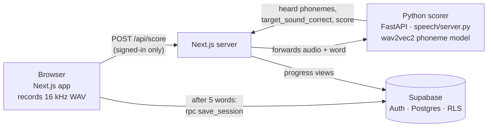

# Chatterbox

**At-home speech practice for kids, with progress parents can actually see.**

Children working on speech sounds often see a speech-language pathologist (SLP)
for as little as 30 minutes a week. Real progress depends on practicing at
home, but parents usually can't tell whether a sound was produced correctly.
Chatterbox makes that practice time count.

A child sees a picture of an animal and says what it is. Chatterbox listens at
the level of individual speech sounds (phonemes) and records whether the child
produced their **target sound**, like /r/ in *rabbit* or /l/ in *lion*. During
practice the child only ever gets a cheer and a *ding*; the details go to the
parent's progress page.

> **Chatterbox is a practice companion, not a diagnostic tool.** It supports the
> work children do with their SLP; it doesn't replace it.

## How it works

1. **A parent signs up** (email and password, no confirmation email) and enters
   their child's first name.
2. **Start a session:** pick a target sound, **/r/** or **/l/**. The child gets
   **5 picture prompts**, one try each.
3. **The child taps the mic and says the word.** The ring around the mic moves
   with their voice. Chatterbox scores the attempt, plays a cheer and a ding
   whether it was right or not, and moves on. No retries, nothing that says
   "wrong".
4. **End of session:** stars, "4 out of 5", and a short list of words to keep
   practicing ("Heard 'w' instead of 'r'"). The session is saved.
5. **View progress:** accuracy over time for each sound, plus the child's
   hardest words, filterable by sound.

## Why phonemes, not speech-to-text

Regular speech recognition is built to understand *words*, so it quietly
autocorrects mispronunciations. It hears "wabbit" and writes "rabbit", which
is useless for speech practice. Chatterbox uses a phoneme recognition model,
[`facebook/wav2vec2-lv-60-espeak-cv-ft`](https://huggingface.co/facebook/wav2vec2-lv-60-espeak-cv-ft),
which outputs the sounds actually spoken (`w æ b ɪ t`). It aligns those
against the expected pronunciation (`ɹ æ b ɪ t`, generated with espeak-ng) to
pinpoint which sound was swapped, dropped, or added.

The scorer judges **only the target sound**: a child who nails the /r/ in
*rabbit* but mumbles the vowel still gets credit. See
[`speech/README.md`](speech/README.md) for the scoring rules and how we
evaluated them.

### Why /l/ instead of /th/

We started with /r/ and /th/. On real recordings the model caught every
mistake for both sounds, but it accepted only **1 in 10 correctly said /th/
words**: it hears a real /θ/ as [f], [t] or [s], so it would have
under-credited kids. /l/, whose classic childhood error is "wion" for *lion*,
scored **97.5% of correct words accepted and 100% of mistakes caught** in
testing, so the demo uses /r/ and /l/.

## Architecture



- **Web app** (`web/`): Next.js 16 (App Router, Cache Components), React 19,
  Tailwind 4, shadcn/ui, recharts. Supabase Auth via `@supabase/ssr`.
  Details: [`web/README.md`](web/README.md).
- **Scoring service** (`speech/`): Python 3.11, FastAPI, Hugging Face
  Transformers + PyTorch. Runs locally; the model (~1.2 GB) loads once at startup.
- **Database** (Supabase Postgres): children → sessions → attempts, a word
  list, a `save_session()` function and three progress views. Every table has
  row-level security, so a parent only sees their own child's data. Full
  reference with an ERD: [`web/supabase/SCHEMA.md`](web/supabase/SCHEMA.md).

## Repository layout

```
chatterbox/
├── speech/                  Python scoring service + evaluation tools
│   ├── scoring/             model, phoneme rules, alignment, scoring
│   ├── server.py            FastAPI: POST /score, GET /health
│   ├── cli.py               score a clip / record from the mic
│   ├── record.py            guided recorder for test clips
│   ├── evaluate.py          accuracy report over labelled clips
│   ├── synth.py             synthetic test clips (macOS `say`)
│   └── tests/               pytest
├── web/                     Next.js app
│   ├── src/app/             routes (landing, auth, /welcome, /session, /practice/[sound], /progress, /api/score)
│   ├── src/components/      UI (shadcn components live in components/ui)
│   ├── src/lib/             Supabase clients, audio recorder, sounds, routes
│   ├── public/assets/       word pictures, named {word}.png
│   ├── scripts/seed.mjs     demo account + fake practice history
│   └── supabase/            migrations + SCHEMA.md
└── requirements.txt         Python dependencies
```

## Getting started (macOS)

### Prerequisites

- [Homebrew](https://brew.sh)
- **Node.js 22 or newer** (`brew install node@24`). Node 20 runs the app, but
  the seed script needs Node 22+ (see [Known issues](#known-issues)).
- A [Supabase](https://supabase.com) project

### 1. System packages

```bash
brew install python@3.11 espeak-ng portaudio
```

- `python@3.11`: stable for torch and transformers
- `espeak-ng`: phonemizes words (used for the word list and test tools)
- `portaudio`: microphone access for the command-line recorder

Point phonemizer at espeak-ng:

```bash
echo "export PHONEMIZER_ESPEAK_LIBRARY=$(brew --prefix)/lib/libespeak-ng.dylib" >> ~/.zshrc
source ~/.zshrc
```

### 2. Python environment (repo root)

```bash
$(brew --prefix)/bin/python3.11 -m venv .venv
.venv/bin/pip install --upgrade pip
.venv/bin/pip install -r requirements.txt
```

The model downloads automatically the first time the scorer starts and is
cached in `~/.cache/huggingface/` (not in this repo). To fetch it ahead of
time: `.venv/bin/hf download facebook/wav2vec2-lv-60-espeak-cv-ft`.

### 3. Web app

```bash
cd web
npm install
cp .env.example .env.local
```

Fill in `web/.env.local` from the Supabase dashboard (**Project Settings → API
Keys** and **Data API**):

| Variable | What it is |
|---|---|
| `NEXT_PUBLIC_SUPABASE_URL` | Project URL |
| `NEXT_PUBLIC_SUPABASE_ANON_KEY` | Publishable / anon key (safe in the browser) |
| `SUPABASE_SECRET_KEY` | Secret / service-role key. **Server only**: never prefix it with `NEXT_PUBLIC_`. Used for no-email sign-up and the seed script. |
| `SCORER_URL` | Where the Python scorer runs. Default `http://127.0.0.1:8000`. |

### 4. Database

From `web/`, link the Supabase CLI to your project (one time; it asks for the
database password), apply the migrations, and seed a demo account:

```bash
npx supabase login
npx supabase link --project-ref <your-project-ref>
npm run db:push
npm run seed
```

The seed creates **`parent@chatterbox.test` / `chatterbox123`** with one child,
Maya, and about four weeks of practice history for both sounds.

### 5. Run it

Two terminals:

```bash
# Terminal 1 (repo root): the scorer. Wait for "Application startup complete" (~20 s).
.venv/bin/uvicorn speech.server:app --port 8000

# Terminal 2 (web/): the app
npm run dev
```

Open <http://localhost:3000>, log in with the demo account (or sign up), and
start a session. The browser asks for the microphone once. On a Mac, pick the
built-in microphone; Bluetooth headset mics often record near-silence.

## Testing the scorer on its own

From the repo root:

```bash
.venv/bin/python -m pytest speech/tests                                  # unit tests
.venv/bin/python -m speech.cli record --word rabbit --loop               # say a word, see the verdict
.venv/bin/python -m speech.record --speaker <name> --sound l             # record labelled test clips
.venv/bin/python -m speech.evaluate speech/samples/<name> --show-misses  # accuracy report
```

Details, options and results: [`speech/README.md`](speech/README.md).

## Useful commands

| Where | Command | What it does |
|---|---|---|
| `web/` | `npm run dev` | App on localhost:3000 |
| `web/` | `npm run build` | Production build (run before merging) |
| `web/` | `npm run lint` | ESLint |
| `web/` | `npm run seed` | Reset the demo account and its fake history |
| `web/` | `npm run seed:user` | Only create/reset the demo login |
| `web/` | `npm run db:push` | Apply new migrations to Supabase |
| `web/` | `npm run db:types` | Regenerate `src/types/database.ts` after a schema change |
| root | `.venv/bin/uvicorn speech.server:app --port 8000` | Scoring service |

## Privacy

Children's audio is never stored. Each recording is scored in memory and
discarded. Only the results (phonemes heard, right or wrong for the target
sound, a score) are saved to track progress.

## Known issues

- **Node 20:** `npm run seed` fails with "native WebSocket not found" because
  the current Supabase client needs Node 22+. Upgrade Node, or run
  `node --experimental-websocket --env-file=.env.local scripts/seed.mjs`.
- **Pushing large files:** the word pictures are big. If `git push` fails with
  `HTTP 400`, run `git config http.postBuffer 157286400` once in this repo.
- **Scorer port in use:** if uvicorn says port 8000 is already in use, an old
  scorer is still running: `kill $(lsof -ti tcp:8000)`.
- **Hackathon shortcuts:** sign-up skips email verification, there's one child
  per parent, and the scorer only runs locally. Fine for a demo, not yet for
  real users.

## What's next

- Fine-tune on child speech for better accuracy with young voices, and revisit /th/
- More target sounds, and practice with the sound in the middle and end of words
- Multiple children per parent
- Host the scorer so the app works beyond a laptop
- A shareable progress report for the child's SLP
