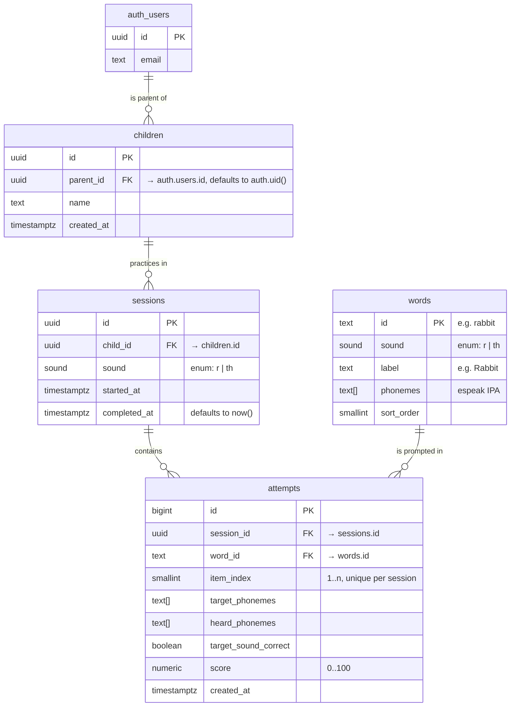
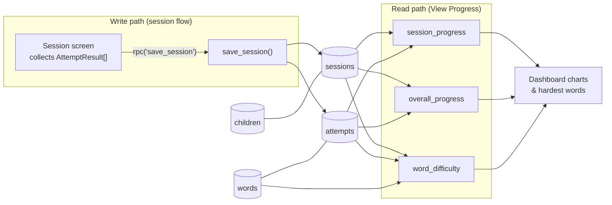

# Chatterbox database schema

Postgres on Supabase. The schema is defined by the migrations in
[`migrations/`](./migrations) (currently one: `20261121231148_progress_schema.sql`).
The TypeScript contract both app halves code against lives in
[`web/src/types/session.ts`](../src/types/session.ts).

**In one sentence:** a parent (Supabase auth user) has children; each child does
practice sessions for one target sound; each session has one attempt per picture;
pictures come from a fixed word list.

## Entity–relationship diagram



`auth.users` is managed by Supabase Auth. We don't create or modify it; there is
no separate parents/profiles table.

## How data moves



- **Writes** go through one function, `save_session()`, called once when a
  session ends. The app never inserts into `sessions`/`attempts` directly.
- **Reads** go through three views shaped for the dashboard. The app never
  aggregates raw attempts itself.

## Types

| Type | Values | Notes |
|---|---|---|
| `public.sound` (enum) | `r`, `th` | Target sound. Displayed as `/r/` and `/th/` (see `web/src/lib/sounds.ts`). Add a sound with `alter type public.sound add value '…'` plus words for it. |

## Tables

### `children`

One row per kid. Belongs to the signed-in parent.

| Column | Type | Notes |
|---|---|---|
| `id` | `uuid` PK | `gen_random_uuid()` |
| `parent_id` | `uuid` not null | FK → `auth.users(id)` **on delete cascade**. Defaults to `auth.uid()`, so the app can insert `{ name }` only. Indexed. |
| `name` | `text` not null | Must not be blank. |
| `created_at` | `timestamptz` | `now()` |

### `sessions`

One practice session: a child working through a set of pictures for **one** sound.

| Column | Type | Notes |
|---|---|---|
| `id` | `uuid` PK | `gen_random_uuid()` |
| `child_id` | `uuid` not null | FK → `children(id)` **on delete cascade** |
| `sound` | `sound` not null | Every word in the session must be this sound (enforced by `save_session`). |
| `started_at` | `timestamptz` not null | Sent by the app when the session began. |
| `completed_at` | `timestamptz` not null | `now()` at save time. Check: `completed_at >= started_at`. |

Index: `(child_id, completed_at)` for per-child timelines.

### `attempts`

One row per picture in a session. **One attempt per picture, no retries:** a
wrong answer is recorded and the child moves on.

| Column | Type | Notes |
|---|---|---|
| `id` | `bigint` PK | Identity. |
| `session_id` | `uuid` not null | FK → `sessions(id)` **on delete cascade** |
| `word_id` | `text` not null | FK → `words(id)`. A word can't be deleted while attempts reference it. Indexed. |
| `item_index` | `smallint` not null | Position in the session, ≥ 1. **Unique per session** `(session_id, item_index)`. |
| `target_phonemes` | `text[]` | What the word should sound like, e.g. `{ɹ,æ,b,ɪ,t}`. |
| `heard_phonemes` | `text[]` | What the model heard, e.g. `{w,æ,b,ɪ,t}`. |
| `target_sound_correct` | `boolean` not null | Did the child produce the *target sound* correctly (not the whole word)? Drives all accuracy numbers. |
| `score` | `numeric(5,2)` not null | 0–100 overall pronunciation score. |
| `created_at` | `timestamptz` | `now()` |

### `words`

The picture list: reference data, seeded by the migration (10 animals per sound).

| Column | Type | Notes |
|---|---|---|
| `id` | `text` PK | Slug, e.g. `rabbit`. This is the `word_id` the session flow sends. |
| `sound` | `sound` not null | Which sound this word practises. |
| `label` | `text` not null | Display text, e.g. `Rabbit`. Shown in the picture box until images exist. |
| `phonemes` | `text[]` not null | espeak-ng `en-us` IPA, one phoneme per element. Same alphabet as the wav2vec2 phoneme model's output. |
| `sort_order` | `smallint` | Display order within a sound. |

Current words: **/r/** rabbit, raccoon, rooster, rhino, reindeer, robin, rat,
frog, parrot, crab · **/th/** moth, sloth, panther, python, mammoth, thrush,
thumb, three, teeth, bath.

### Deletes cascade downward

Deleting a parent's auth user → their children → those children's sessions →
those sessions' attempts. Words are never deleted by a cascade.

## Write path: `save_session()`

```sql
save_session(p_child_id uuid, p_sound sound, p_started_at timestamptz, p_attempts jsonb) returns uuid
```

Matches `SaveSessionArgs` in `session.ts`. Called from the app as:

```ts
const { data: sessionId, error } = await supabase.rpc("save_session", {
  p_child_id, p_sound, p_started_at, p_attempts, // AttemptResult[]
});
```

What it does, **in one transaction** (all or nothing):

1. Rejects `p_attempts` that is not a non-empty JSON array.
2. Checks the child exists *and belongs to the caller*. RLS hides other
   parents' children, so this doubles as an ownership check.
3. Inserts the `sessions` row (`completed_at = now()`).
4. Inserts one `attempts` row per element of `p_attempts`.
5. Rejects the whole save if any word's sound ≠ `p_sound`.
6. Returns the new session id.

Runs as **security invoker**, so the caller's RLS still applies. Only
`authenticated` users can execute it.

| Error | When |
|---|---|
| `22023` invalid parameter | Empty/non-array `p_attempts`, or a word from the wrong sound. |
| `P0002` not found | Child doesn't exist or isn't the caller's. |
| `23505` unique violation | Two attempts with the same `item_index`. |
| `23503` foreign key | `word_id` not in `words`. |
| `23514` check | `score` outside 0–100, `item_index` < 1. |

Partial sessions (e.g. the child ends early after 6 pictures) are allowed: send
the attempts you have. The views compute from the attempts that exist.

## Read path: views

All three are `security_invoker`, so a parent only ever sees rows for their own
children. Columns match the `*Row` types in `session.ts`.

### `session_progress`: one row per session

Per-sound accuracy chart.

| Column | Meaning |
|---|---|
| `child_id`, `session_id`, `sound`, `completed_at` | From `sessions`. |
| `total_items` | Number of attempts in the session. |
| `correct_count` | Attempts with `target_sound_correct = true`. |
| `accuracy` | `correct_count / total_items × 100`, 1 decimal. |

### `overall_progress`: one row per child per day

Overall chart, all sounds combined.

| Column | Meaning |
|---|---|
| `child_id` | |
| `day` | `completed_at` as a **UTC** date (`"2026-11-21"`). An evening session in US time can land on the next day. |
| `total_items`, `correct_count`, `accuracy` | Summed across every session that day. |

### `word_difficulty`: one row per child per word

"Hardest words" list. Sort by `miss_rate desc`.

| Column | Meaning |
|---|---|
| `child_id`, `word_id`, `sound` | |
| `attempts` | Times the word was attempted. |
| `misses` | Attempts with `target_sound_correct = false`. |
| `miss_rate` | `misses / attempts × 100`, 1 decimal. |

## Security

Row-level security is on for every table. Signed-out (`anon`) users have **no**
access to anything; requests fail with `permission denied`.

| Object | Signed-in parent can… |
|---|---|
| `words` | read all rows |
| `children` | read / insert / update / delete **their own** (`parent_id = auth.uid()`) |
| `sessions` | read / insert / delete for **their own children** |
| `attempts` | read / insert for **their own children's** sessions |
| views | read rows for **their own children** (inherits the table rules above) |
| `save_session()` | execute |

The service-role / secret key bypasses all of this. It's used only by
`web/scripts/seed.mjs` and must never reach the browser.

## Working with the schema

Run from `web/`.

| Task | Command |
|---|---|
| Create a migration | `npx supabase migration new <name>`, then edit the new file in `supabase/migrations/` |
| Preview what would be applied | `npx supabase db push --remote --dry-run` |
| Apply migrations | `npm run db:push` |
| Regenerate TypeScript types | `npm run db:types` (writes `src/types/database.ts`) |
| Seed test parent + fake data | `npm run seed` (needs `SUPABASE_SECRET_KEY` in `.env.local`) |
| Just the test user | `npm run seed:user` → `parent@chatterbox.test` / `chatterbox123` |
| Security/performance checks | `npx supabase db advisors --remote` |

Never edit a migration that has already been pushed; add a new one. After any
schema change, regenerate types and update `session.ts` if the contract changed
(both app halves need to agree).
